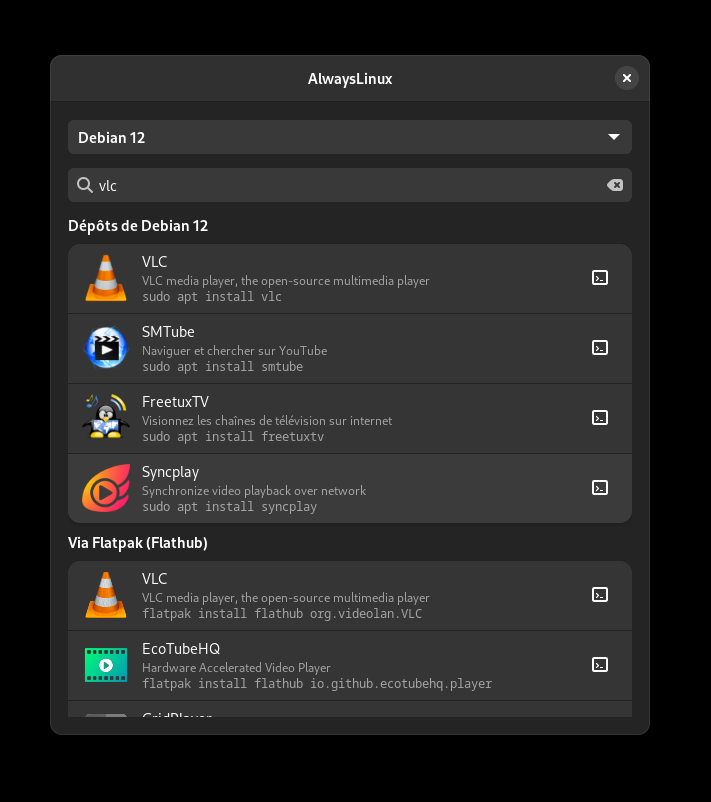
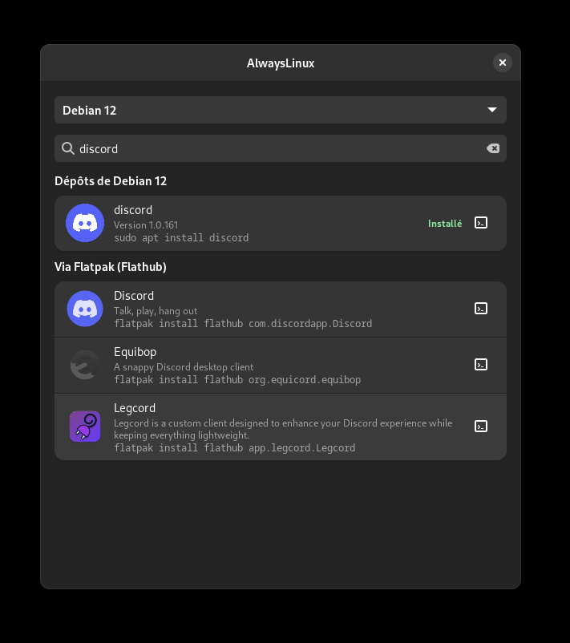

# AlwaysLinux

**Find the install command for any Linux app, on your distro.**

Type the name of an app, and AlwaysLinux tells you the exact command to install it — from your
distribution's repositories (`apt`, `dnf`, `pacman`, `zypper`, `apk`, `xbps`) and from Flathub —
with logos, versions and an "Installed" badge for what you already have.

<p align="center">
  
  
</p>

> The interface is currently in French.

## Features

- **Detects your distro** automatically (Debian, Ubuntu, Mint, Fedora, Arch, Manjaro, openSUSE, Alpine, Void),
  and lets you look up the command for any other distro in the list.
- **Instant and offline on Debian/Ubuntu/Mint and Arch/Manjaro**: reads the local AppStream catalog and
  `apt-cache` or `pacman` — no network needed, results in about 0.25 s.
- **Flatpak results** from the local Flathub catalog (or the Flathub API if Flatpak isn't installed).
- **"Installed" badge** for distro packages and Flatpaks already on your machine.
- **Opens a terminal with the command pre-filled**, but never runs it: you review it, press Enter to run,
  or Ctrl+C to cancel. The command is also copied to the clipboard.
- **Suggestions** when no package matches the exact name.
- Results from other distros come from [Repology](https://repology.org) and are cached on disk for 7 days
  (`~/.cache/alwayslinux/`).

## Install

Download the package for your distro from the
[latest release](https://github.com/blaspheme42/AlwaysLinux/releases/latest).

**Debian / Ubuntu / Mint**

```bash
wget https://github.com/blaspheme42/AlwaysLinux/releases/latest/download/alwayslinux_0.2.0_all.deb
sudo apt install ./alwayslinux_0.2.0_all.deb
```

**Arch / Manjaro**

```bash
wget https://github.com/blaspheme42/AlwaysLinux/releases/latest/download/alwayslinux-0.2.0-1-any.pkg.tar.zst
sudo pacman -U alwayslinux-0.2.0-1-any.pkg.tar.zst
```

Then launch **AlwaysLinux** from your app menu, or run `alwayslinux`.

For the best experience, also install AppStream (the app suggests the right command if it's missing):
`sudo apt install appstream` / `sudo pacman -S appstream archlinux-appstream-data`.

**Run from source** (any distro with GTK 4 and libadwaita for Python):

```bash
python3 alwayslinux.py
```

## How it works

| Source | Used for |
|---|---|
| `appstreamcli` (local) | App names, descriptions and logos — distro packages and Flatpaks |
| `apt-cache policy` / `pacman -Si -Q` (local) | Available version and installed status on apt- and pacman-based distros |
| `flatpak list` (local) | Installed Flatpaks |
| [Repology API](https://repology.org/api) | Package names for distros other than yours |
| [Flathub API](https://flathub.org) | Flatpak results when Flatpak or its local catalog isn't available |

The whole app is a single Python file using GTK 4 and libadwaita. Run the built-in self-test with
`python3 alwayslinux.py --test`.

## Building the packages

```bash
./build-deb.sh    # → alwayslinux_<version>_all.deb
./build-arch.sh   # → alwayslinux-<version>-1-any.pkg.tar.zst (uses makepkg, or an Arch container via podman)
```

Both scripts run the self-test first and stop if it fails.

## Limitations

- Fully local mode only works on apt- and pacman-based distros for now; other distros use Repology for repository results.
- Package names are matched automatically and can occasionally be wrong (e.g. openSUSE names Firefox `MozillaFirefox`).
- Local results are only as fresh as your last `apt update` / `pacman -Sy` / `flatpak update --appstream`.

## License

[MIT](LICENSE)
